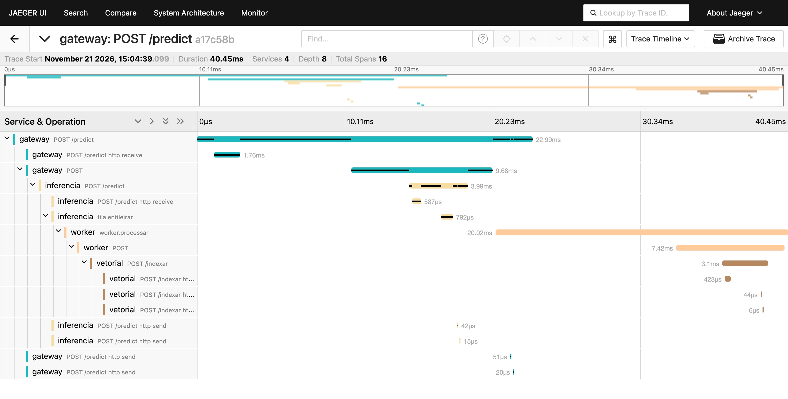
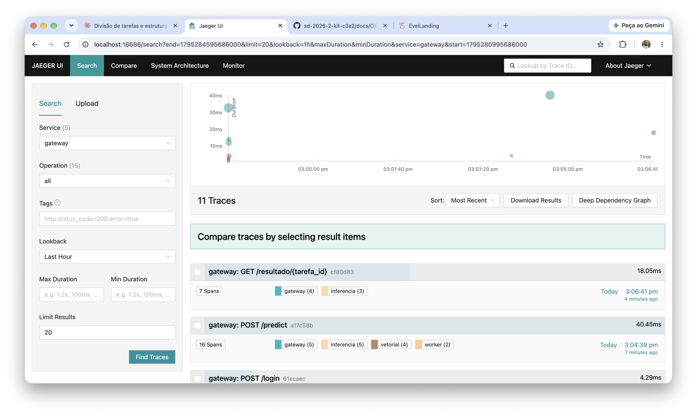

# Observabilidade — rastreamento distribuído

> Responsável: Lucas

## Como funciona

Usamos **OpenTelemetry** e o **Jaeger** (UI em http://localhost:16686 ao subir o compose).
Uma requisição gera **um único `trace_id`** atravessando todos os serviços:

```
cliente → gateway ──HTTP──▶ inferencia ──Redis (fila)──▶ worker ──HTTP──▶ vetorial
          span POST /predict   span POST /predict   fila.enfileirar   span worker.processar   span POST /indexar
```

- **HTTP** (gateway → inferência, worker → vetorial): o cabeçalho W3C `traceparent` é enviado e lido
  automaticamente pelas instrumentações do `requests` e do FastAPI.
- **Fila (Redis):** não há cabeçalho HTTP, então `injetar_contexto()` grava o `traceparent` **dentro da
  mensagem da tarefa** e o worker usa `extrair_contexto()` para continuar o mesmo trace
  (`worker.processar` vira filho do span que enfileirou).
- O arquivo `telemetria.py` é o mesmo nos 4 serviços (`gateway/`, `vetorial/`, `inferencia/app/`, `worker/app/`).

## Como ver

1. `docker compose up --build`
2. Faça login e um `POST /predict` (ou rode `python scripts/smoke_test.py`).
3. Abra http://localhost:16686 → *Service*: `gateway` → *Find Traces* → abra o trace: aparecem
   `gateway`, `inferencia`, `worker` e `vetorial` no mesmo rastro.

Sem Jaeger: `OTEL_CONSOLE=true` imprime os spans no log de cada container (compare o `trace_id`).

## Evidência: trace real de um `POST /predict`

Captura feita no Jaeger com a plataforma rodando via `docker compose` (21/11/2026).



O que a imagem mostra:

- **Um único trace (`a17c58b`) com 16 spans e 4 serviços**: `gateway`, `inferencia`, `worker` e `vetorial`.
- **Propagação pela fila:** o span `worker.processar` aparece **dentro** de `inferencia → fila.enfileirar`.
  Entre os dois não há HTTP, só o Redis; o vínculo existe porque o `traceparent` viajou dentro da mensagem da tarefa.
- **Chamada ao armazenamento vetorial:** o worker chama `vetorial → POST /indexar` e esse span também fica no mesmo trace.
- **Comportamento assíncrono visível:** o span do gateway termina em ~23 ms (ele devolve o `202` logo após enfileirar),
  enquanto o `worker.processar` (~20 ms) continua depois disso. O trace todo dura 40,45 ms.
- **Tempos de cada etapa:** `fila.enfileirar` leva ~0,8 ms; a indexação no vetorial, ~3 ms.

Visão geral da busca (serviço `gateway`, 11 traces): cada rota gera o seu trace
(`POST /login`, `POST /predict`, `GET /resultado/{id}`), e o de `POST /predict` é o único que passa
pelos 4 serviços, porque é o único que usa a fila.



## LGPD
Os spans guardam só método, rota, status e tempos — nunca o texto do usuário.
